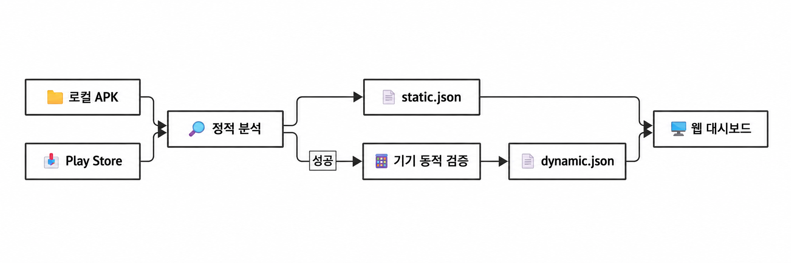

# 🚀 UnIntent

## 📖 프로젝트 소개

UnIntent는 KISA Whitehat School 4th 2단계 프로젝트에서 개발한 안드로이드 앱 인텐트 취약점 분석 도구입니다. 정적 분석과 동적 검증을 통해 **Intent Redirection**, **Intent Injection**, **Intent Spoofing** 세 유형의 취약점을 탐지합니다.

### 분석 흐름



정적 분석 결과는 `static.json`에, 동적 검증 결과는 `dynamic.json`에 저장됩니다. 동적 검증은 정적 분석이 성공하면 진행합니다.

### 실행 방식

| 시작 방법 | 필요한 것 |
| --- | --- |
| 📁 로컬 APK 분석 | APK 파일, ADB로 연결된 안드로이드 에뮬레이터 또는 실기기 |
| 📥 패키지명으로 추출 후 분석 | 패키지명 목록, Google Play가 설치된 기기 |
| 🔝 Google Play Top 100 앱 분석 | Google Play가 설치된 기기 |

> **기기 연결:** 에뮬레이터 또는 USB 디버깅을 허용한 실기기를 사용할 수 있습니다. 분석을 시작하기 전에 `adb devices`에서 상태가 `device`인 기기 한 대를 확인하세요. 특히 `-d`와 `-t`를 사용할 때는 기기를 자동으로 선택할 수 있도록 한 대만 연결해야 합니다.

---

## 🧭 목차

1. [빠른 시작](#quick-start)
2. [환경 설정](#setup)
3. [CLI 사용법](#cli)
4. [웹 대시보드](#dashboard)
5. [Discord 알림](#discord)
6. [MCP 서버 연결](#mcp)
7. [팀 소개](#team)

---

<a id="quick-start"></a>

## ⚡ 빠른 시작

1. 아래 [환경 설정](#setup)을 완료합니다.
2. 분석할 APK를 `data/apks/targets/`에 넣습니다.
3. 연결된 기기를 확인한 뒤 프로젝트 루트에서 실행합니다.

```bash
adb devices
python src/UnIntent.py
```

정적 분석이 성공하면 연결된 기기에서 동적 검증을 시도합니다.

---

<a id="setup"></a>

## ⚙️ 환경 설정

### 준비물

| 항목 | 용도 | 필요 시점 |
| --- | --- | --- |
| Python | CLI, 분석기, MCP 서버, 대시보드 실행 | 항상 |
| ADB | 기기 연결, APK 설치 및 동적 검증 | 전체 분석 시 |
| Android 에뮬레이터 또는 실기기 | 분석 대상 앱 실행 | 전체 분석 시 |
| Google Play가 설치된 기기 | 앱을 설치하고 기기에서 APK 추출 | `-d`, `-t` 사용 시 |
| Node.js와 npm | 웹 대시보드의 프런트엔드 의존성 설치 | 대시보드 사용 시 |

**ADB 설치:** `adb`가 없다면 Android SDK Platform-Tools를 설치하고, `adb` 실행 파일이 있는 디렉터리를 `PATH`에 추가하세요. 에뮬레이터를 사용한다면 Android Studio에서 AVD를 만들고 실행합니다. 실기기를 사용한다면 개발자 옵션에서 **USB 디버깅**을 켜고 컴퓨터의 디버깅 요청을 허용합니다. 에뮬레이터를 명령줄에서 시작하려면 `emulator` 실행 파일도 `PATH`에서 찾을 수 있어야 합니다.

<a id="python-setup"></a>

### Python 및 의존성 설치

Python이 없다면 먼저 설치하세요. 아래 명령은 Python 자체를 설치하는 과정이 아니라 가상환경을 만들고 프로젝트 의존성을 설치하는 과정입니다. CLI, 대시보드, MCP 서버를 소스에서 실행하려면 Python과 `requirements.txt`의 패키지가 필요합니다. 가상환경은 선택 사항이지만 사용을 권장합니다.

프로젝트 루트에서 운영체제에 맞는 명령을 실행합니다.

**Windows PowerShell**

```powershell
python -m venv .venv #최초 1회
.\.venv\Scripts\Activate.ps1
python -m pip install -r requirements.txt
```

**macOS / Linux (bash, zsh)**

```bash
python3 -m venv .venv #최초 1회
source .venv/bin/activate
python -m pip install -r requirements.txt
```

이후의 `python` 명령은 활성화한 가상환경에서 실행합니다. 새 터미널을 열었다면 가상환경을 다시 활성화하세요. 가상환경을 사용하지 않는 경우에도 필요한 패키지는 설치해야 합니다.

### ADB 연결 확인

```bash
adb devices
```

출력에 기기 식별자와 `device` 상태가 표시되어야 합니다. 에뮬레이터를 사용한다면 AVD를 먼저 실행하고, 실기기를 사용한다면 USB 디버깅 승인 화면을 확인하세요.

---

<a id="cli"></a>

## ⌨️ CLI 사용법

모든 명령은 **프로젝트 루트**에서 실행합니다. 기본 실행은 `data/apks/targets/` 안의 `*.apk` 파일을 분석합니다.

| 목적 | 명령 | 입력 |
| --- | --- | --- |
| 도움말 보기 | `python src/UnIntent.py --help` | 없음 |
| 📁 로컬 APK 분석 | `python src/UnIntent.py` | `data/apks/targets/*.apk` |
| 📥 패키지명 목록의 앱 분석 | `python src/UnIntent.py -d` | `data/apks/target.txt` |
| 🔝 Google Play Top 100 앱 분석 | `python src/UnIntent.py -t` | Google Play 목록 |
| 정적 분석 시간 제한 설정 | `python src/UnIntent.py --time-out 120` | 120초로 설정; 기본값은 제한 없음 |
| 최대 호출 깊이 설정 | `python src/UnIntent.py --depth 5` | 기본값 10 (1부터 설정 가능) |

`--time-out`과 `--depth`는 위 분석 방식과 함께 사용할 수 있습니다. `-d`와 `-t`는 동시에 사용할 수 없습니다.

### 로컬 APK 분석

`data/apks/targets/`에 APK 파일을 넣고 `python src/UnIntent.py`를 실행합니다. 정적 분석이 성공하면 연결된 에뮬레이터 또는 실기기에서 동적 검증을 진행합니다.

### 패키지명으로 앱 분석하기

프로젝트 루트의 `data/apks/target.txt`에 **한 줄에 패키지명 하나씩** 입력합니다.

```text
com.example.app
com.example.otherapp
```

그다음 `python src/UnIntent.py -d`를 실행합니다. 설치된 앱은 기기에서 APK를 추출하고, 설치되지 않은 앱은 Google Play에서 설치한 뒤 APK를 추출해 분석합니다. `-t`는 Google Play Top 100 패키지 목록에 같은 과정을 적용합니다.

분석 결과는 `data/results/<패키지명>/static.json`과 `data/results/<패키지명>/dynamic.json`에 저장됩니다. 정적 분석에 실패하면 동적 검증은 실행되지 않습니다.

---

<a id="dashboard"></a>

## 🖥️ 웹 대시보드

앞서 Python 의존성을 설치한 뒤 Node.js와 npm도 설치합니다. 프로젝트 루트에서 다음 명령을 실행하세요.

```bash
cd web
npm ci
python app.py
```

브라우저에서 http://127.0.0.1:5056을 엽니다. 대시보드는 `data/results/<패키지명>/`에 저장된 분석 결과를 보여줍니다. 등록된 AVD가 있으면 `app.py`가 첫 번째 AVD의 실행을 시도합니다.

---

<a id="discord"></a>

## 🔔 선택 사항: Discord 알림

프로젝트 루트에 `.env` 파일을 만들고 Discord Webhook URL과 분석가 이름을 설정합니다. 설정하지 않아도 분석은 실행됩니다.

```dotenv
DISCORD_WEBHOOK_URL="Discord Webhook URL"
ANALYST_NAME="분석가 이름"
```

---

<a id="mcp"></a>

## 🔌 MCP 서버 연결

UnIntent MCP 서버를 사용하려면 `mcp_server/server.py`를 **프로젝트 가상환경의 Python**으로 실행합니다. 먼저 [Python 및 의존성 설치](#python-setup)를 완료하세요. Codex 앱과 Codex CLI는 MCP 설정을 공유하므로 둘 중 한 곳에서만 등록하면 됩니다.

### Codex 데스크톱 앱 (GUI)

1. **설정 → MCP servers → Add server**를 엽니다.
2. 서버 이름은 `unintent`, 연결 방식은 **STDIO**로 설정합니다. 실행 명령에는 가상환경의 Python **절대 경로**, 인수에는 `mcp_server/server.py`의 **절대 경로**를 입력합니다. 아래 예시 경로를 실제 프로젝트 위치에 맞게 바꾸세요.

   | 입력 항목 | Windows | macOS / Linux |
   | --- | --- | --- |
   | 실행 명령 (`command`) | `C:\path\to\UnIntent\.venv\Scripts\python.exe` | `/path/to/UnIntent/.venv/bin/python` |
   | 인수 (`args`) | `C:\path\to\UnIntent\mcp_server\server.py` | `/path/to/UnIntent/mcp_server/server.py` |

3. 저장한 뒤 **Restart**를 누릅니다. 채팅 입력창에서 `/mcp`를 입력해 `unintent` 서버가 연결됐는지 확인합니다. 이후 "`unintent`의 `analyze_apk`로 작업 폴더의 APK를 분석해줘"처럼 요청할 수 있습니다.

`analyze_apk`는 서버의 작업 폴더 최상위에 있는 APK 파일 **하나**를 찾습니다. 다른 폴더를 사용한다면 `~/.codex/config.toml`의 `[mcp_servers.unintent]`에 `cwd`를 그 폴더의 절대 경로로 설정하거나 `UNINTENT_WORKSPACE` 환경 변수를 지정하세요.

### Claude Desktop (GUI)

Claude Desktop 앱의 **Settings → Developer → Edit Config**에서 `claude_desktop_config.json`을 엽니다. Windows에서는 `%APPDATA%\Claude\claude_desktop_config.json`, macOS에서는 `~/Library/Application Support/Claude/claude_desktop_config.json`에 있습니다.

`mcpServers`에 아래 `unintent` 항목을 추가합니다. 예시는 **Windows** 기준입니다. Python 가상환경, 서버 파일, APK 폴더의 경로를 각각 실제 **절대 경로**로 바꾸세요. JSON의 Windows 경로에는 아래처럼 `/`를 쓰거나 `\\`로 이스케이프한 역슬래시를 사용합니다. 다른 서버가 이미 있다면 기존 설정은 유지하고 `mcpServers` 안에 `unintent` 항목만 추가하세요.

```json
{
  "mcpServers": {
    "unintent": {
      "command": "C:/path/to/UnIntent/.venv/Scripts/python.exe",
      "args": ["C:/path/to/UnIntent/mcp_server/server.py"],
      "env": {
        "UNINTENT_WORKSPACE": "C:/path/to/apk-folder"
      }
    }
  }
}
```

macOS / Linux에서는 `command`에 `/path/to/UnIntent/.venv/bin/python`, `args`에 `/path/to/UnIntent/mcp_server/server.py`를 지정합니다. `UNINTENT_WORKSPACE`에는 APK 폴더의 절대 경로를 입력하세요. `analyze_apk`를 사용하려면 해당 폴더의 **최상위에 APK를 하나만** 두세요.

파일을 저장하고 Claude Desktop을 **완전히 종료한 뒤 다시 실행**합니다. 채팅 입력창의 **+ → Connectors**에서 `unintent` 도구가 보이는지 확인한 다음, "`unintent`의 `analyze_apk`로 APK를 분석해줘"라고 요청할 수 있습니다. 연결되지 않으면 **Settings → Developer**의 MCP 로그와 위 경로를 확인하세요.

> 이 설정은 **Claude Desktop 채팅용**입니다. 아래 Claude Code 터미널 설정과는 별개입니다. 이 저장소는 `.mcpb` 확장 패키지를 제공하지 않으므로 Claude Desktop의 **Extensions → Install Extension** 대신 위의 로컬 서버 설정을 사용합니다.

### 터미널 (Codex CLI / Claude Code)

아래 명령은 프로젝트 루트에서 실행합니다. 사용하는 클라이언트의 명령만 등록하세요.

**Windows PowerShell**

```powershell
$python = (Resolve-Path .\.venv\Scripts\python.exe).Path
$server = (Resolve-Path .\mcp_server\server.py).Path

# Codex CLI
codex mcp add unintent -- $python $server

# Claude Code
claude mcp add --transport stdio --scope user unintent -- $python $server
```

**macOS / Linux (bash, zsh)**

```bash
python_path="$PWD/.venv/bin/python"
server_path="$PWD/mcp_server/server.py"

# Codex CLI
codex mcp add unintent -- "$python_path" "$server_path"

# Claude Code
claude mcp add --transport stdio --scope user unintent -- "$python_path" "$server_path"
```

연결 확인: Codex CLI는 `codex mcp list`, Claude Code는 `claude mcp list`를 실행합니다. Codex에서 긴 분석 작업의 제한 시간을 늘려야 한다면 `~/.codex/config.toml`의 `[mcp_servers.unintent]` 항목에 `tool_timeout_sec = 7200`을 추가할 수 있습니다.

연결 후에는 MCP 클라이언트에서 다음 도구를 요청할 수 있습니다.

| 도구 | 사용 방법 |
| --- | --- |
| `analyze_apk` | 현재 작업 폴더의 최상위에 APK 파일 **하나**를 두고 분석합니다. |
| `analyze_app(package_name)` | 패키지명으로 앱의 APK를 추출해 분석합니다. 앱이 설치되지 않았다면 기기의 Google Play에서 먼저 설치합니다. |
| `get_analysis_seeds`, `get_flow` | 분석 후보 목록과 개별 흐름의 근거를 확인합니다. |

[Codex MCP 공식 문서](https://learn.chatgpt.com/docs/extend/mcp) · [Claude Desktop 로컬 MCP 설정](https://modelcontextprotocol.io/docs/develop/connect-local-servers) · [Claude Code MCP 문서](https://code.claude.com/docs/en/mcp)

---

<a id="team"></a>

## 🎖️ 팀 소개

| 역할 | 이름 | GitHub |
| --- | --- | --- |
| **Mentor** | 김주원 | [@arrester](https://github.com/arrester) |
| **PL** | 장정안 | [@jhanks](https://github.com/jhanks) |
| **PM** | 안효빈 | [@paniby](https://github.com/paniby) |
| **Team** | 김민석 | [@LazyBear8372](https://github.com/LazyBear8372) |
| **Team** | 권민준 | [@jjagong](https://github.com/jjagong) |
| **Team** | 나웅재 | [@UngjaeNa](https://github.com/UngjaeNa) |
| **Team** | 방예현 | [@asdfaat](https://github.com/asdfaat) |
| **Team** | 배진석 | [@spe4r1](https://github.com/spe4r1) |
| **Team** | 배준영 | [@chunbae74](https://github.com/chunbae74) |
| **Team** | 신정헌 | [@bboongdadak](https://github.com/bboongdadak) |
